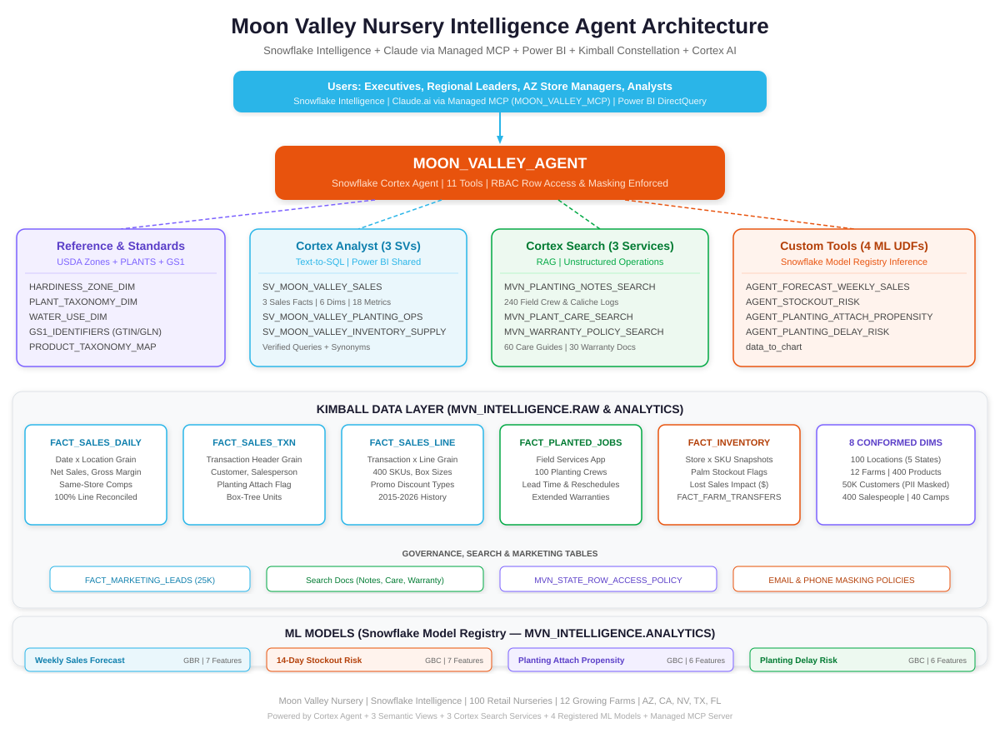
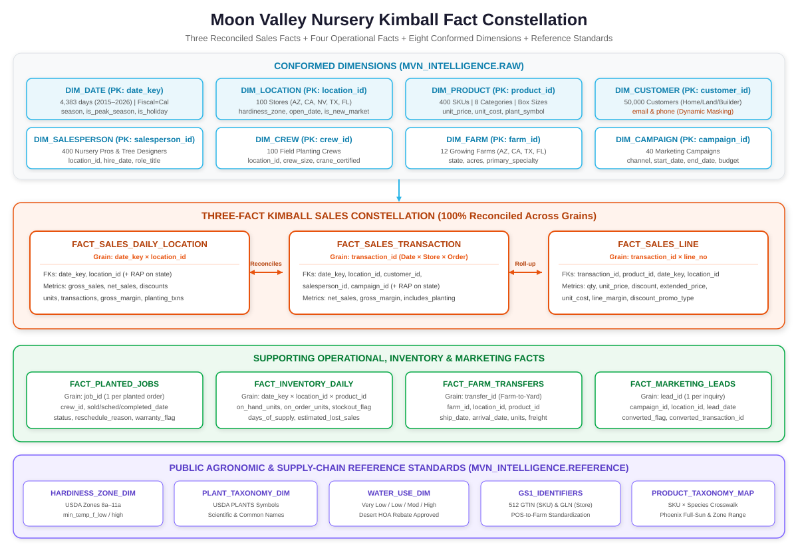
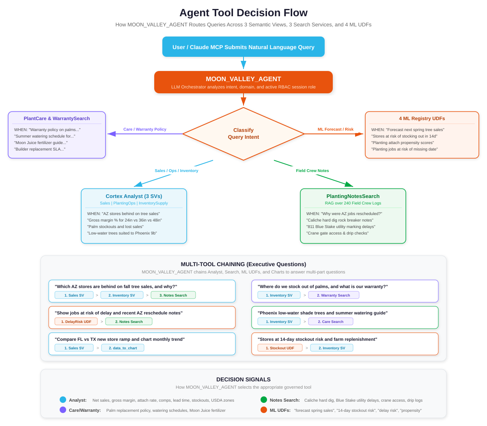
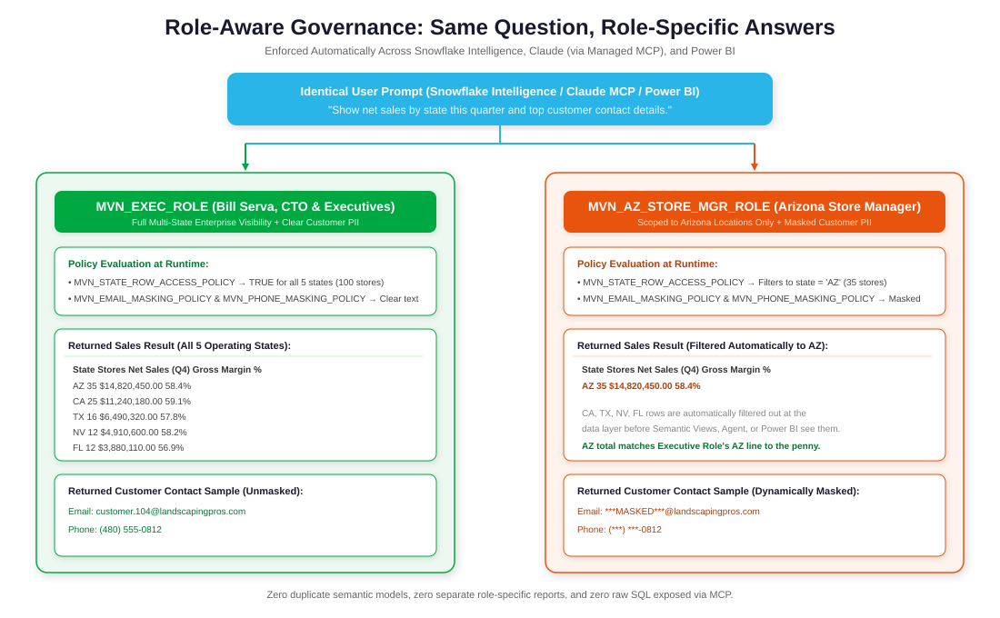
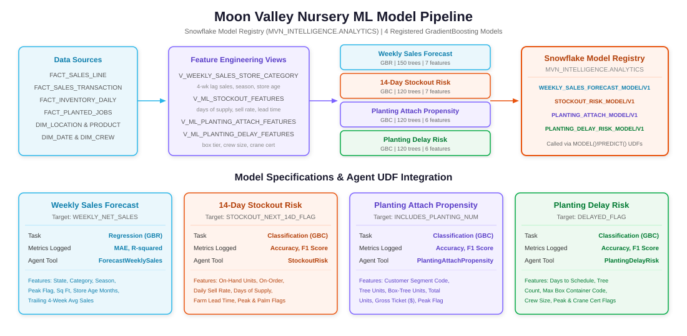
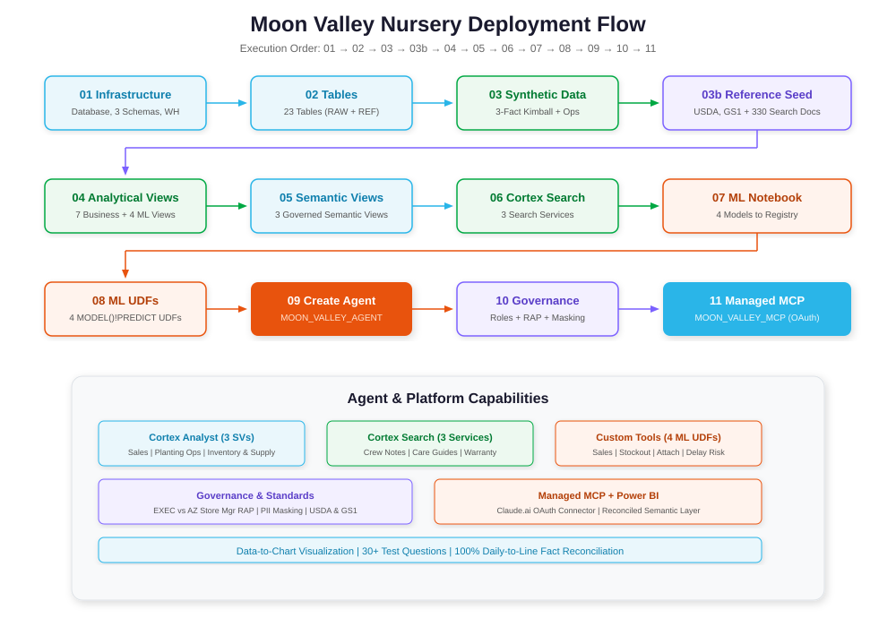

# Moon Valley Nursery — Retail Sales, Inventory & Planting-Operations Intelligence Agent

A governed Snowflake Intelligence and Cortex Agent architecture for **Moon Valley Nursery** ("farm-to-yard" vertically integrated retail tree and plant nursery). This project reproduces Moon Valley's existing **Kimball star schema** (three reconciled sales fact tables plus conformed dimensions) in Snowflake, adds professional planting operations, daily store inventory, marketing leads, and USDA/GS1 reference standards, and exposes everything simultaneously to **Snowflake Intelligence**, **Power BI**, and **Claude.ai (via a Snowflake-managed MCP server)**.

## What This Demo Proves (The 2027 Plan Delivered Today)

During discovery with **Catherine Digua (Data Lead)** and **Bill Serva (CTO)**, Moon Valley outlined a 2027 roadmap requiring a separate semantic-layer database, an interactive cube (referred to in discovery as an "SSIS cube", i.e., an **SSAS / SQL Server Analysis Services** tabular/multidimensional cube), Power BI for field users, and an MCP connection to Claude for executive natural-language questions—all maintained by a lean data team.

This project demonstrates that **Snowflake Semantic Views + Cortex Agent + a Snowflake-managed MCP server** deliver that entire 2027 architecture today with zero extra infrastructure to host:

1. **One semantic layer replaces the separate semantic database and SSAS cube.** Business definitions, synonyms, relationships, and verified queries live in governed Snowflake Semantic Views.
2. **Claude connects through a Snowflake-managed MCP server (`MOON_VALLEY_MCP`)** that exposes **only** the Cortex Agent (`CORTEX_AGENT_RUN`) via OAuth—no raw SQL (`SYSTEM_EXECUTE_SQL`) and no self-hosted MCP server.
3. **Governance is automatic across every interface.** Queries run as the signed-in user: an Arizona Store Manager (`MVN_AZ_STORE_MGR_ROLE`) sees only Arizona stores and masked customer PII, while Executives (`MVN_EXEC_ROLE`) see all 5 states (`AZ`, `CA`, `NV`, `TX`, `FL`) and unmasked customer details.
4. **Answers match Power BI to the penny.** Power BI connects to the exact same Semantic Views and reconciled Kimball facts that power the Cortex Agent and Claude.
5. **Their Kimball model carries over unchanged.** The three-fact sales constellation (`FACT_SALES_DAILY_LOCATION`, `FACT_SALES_TRANSACTION`, `FACT_SALES_LINE`) reconciles 100.00% across all grains.

---

## System Architecture

---

## Kimball Star Schema & Fact Constellation

### Conformed Dimensions (`MVN_INTELLIGENCE.RAW`)

| Table | Grain | Key Fields |
|-------|-------|------------|
| `DIM_DATE` | 1 row per day (2015–2026) | `date_key`, `calendar_date`, `week`, `month`, `quarter`, `year` (fiscal=calendar), `season`, `is_holiday`, `is_peak_season` |
| `DIM_LOCATION` | 1 row per nursery (100) | `location_id`, `location_name`, `city`, `state` (AZ/CA/NV/TX/FL), `region`, `market`, `open_date`, `sq_ft`, `hardiness_zone`, `is_new_market` |
| `DIM_FARM` | 1 row per growing farm (12) | `farm_id`, `farm_name`, `state`, `acres`, `primary_specialty` |
| `DIM_PRODUCT` | 1 row per SKU (400) | `product_id`, `sku`, `product_name`, `category` (Shade Trees, Palms, Fruit Trees, Flowering Trees, Shrubs, Groundcover, Fertilizer & Soil, Services), `container_size` (`15 gal`, `24in box`, `36in box`, `48in box+`), `unit_price`, `unit_cost`, `water_use`, `plant_symbol` |
| `DIM_CUSTOMER` | 1 row per customer (50,000) | `customer_id`, `customer_name`, `customer_type` (Homeowner, Landscaper, Builder/Commercial), `zip`, `state`, `first_purchase_date`, `email` (masked), `phone` (masked) |
| `DIM_SALESPERSON` | 1 row per salesperson (400) | `salesperson_id`, `name`, `location_id`, `hire_date`, `role_title` |
| `DIM_CREW` | 1 row per planting crew (100) | `crew_id`, `crew_name`, `location_id`, `crew_size`, `crane_certified` |
| `DIM_CAMPAIGN` | 1 row per campaign (40) | `campaign_id`, `campaign_name`, `channel`, `start_date`, `end_date`, `region`, `budget_usd` |

### Three-Fact Sales Constellation & Supporting Facts (`MVN_INTELLIGENCE.RAW`)

| Table | Grain | Description |
|-------|-------|-------------|
| `FACT_SALES_DAILY_LOCATION` | `date_key × location_id` | Daily store summary sales, margin, units, transactions, and planting attach counts (100% reconciled to `FACT_SALES_LINE`) |
| `FACT_SALES_TRANSACTION` | `transaction_id` | POS transaction header linking customer, salesperson, campaign, box-tree count, and `includes_planting_flag` |
| `FACT_SALES_LINE` | `transaction_id × line_no` | POS line items with SKU, container size, promo discount type, extended price, cost, and line margin |
| `FACT_PLANTED_JOBS` | `job_id` | Field services planting jobs with crew assignment, sold/scheduled/completed dates, reschedule reasons, and warranty flag |
| `FACT_INVENTORY_DAILY` | `date_key × location_id × product_id` | Store × SKU inventory snapshots, days of supply, palm stockout flags, and estimated lost sales ($) |
| `FACT_FARM_TRANSFERS` | `transfer_id` | Farm-to-store tree and palm replenishment shipments |
| `FACT_MARKETING_LEADS` | `lead_id` | Marketing leads by campaign and store linked to converted POS transactions |

### Agronomic & Supply-Chain Reference Standards (`MVN_INTELLIGENCE.REFERENCE`)

| Table | Standard | Purpose |
|-------|----------|---------|
| `HARDINESS_ZONE_DIM` | USDA Plant Hardiness Zone Map | Zones `8a`–`11a` extreme minimum temperature bounds and Moon Valley market mapping |
| `PLANT_TAXONOMY_DIM` | USDA PLANTS Database | Standardized plant symbols (`PAFL6`, `PRCH`, `QUVI`, `PHDA4`, etc.), scientific names, and growth habits |
| `WATER_USE_DIM` | Regional WUCOLS / Xeriscape | Water-use classifications (`Very Low`, `Low`, `Moderate`, `High`) and desert HOA rebate eligibility |
| `GS1_IDENTIFIERS` | GS1 Standards (GTIN / GLN) | 512 standardized 14-digit GTINs (SKUs) and 13-digit GLNs (nursery stores and farms) |
| `PRODUCT_TAXONOMY_MAP` | Internal Crosswalk | Maps 400 POS SKUs to USDA taxonomy, survivable zone ranges, and 115°F+ Phoenix full-sun ratings |

---

## Agent Tools & Decision Routing (`MOON_VALLEY_AGENT`)

| Tool Name | Tool Type | Target Object | Purpose |
|-----------|-----------|---------------|---------|
| `SalesAnalyst` | `cortex_analyst_text_to_sql` | `SV_MOON_VALLEY_SALES` | 3-fact Kimball sales, margin, box-tree mix, discounts, same-store comps, FL/TX store ramp, customer segments, campaigns |
| `PlantingOpsAnalyst` | `cortex_analyst_text_to_sql` | `SV_MOON_VALLEY_PLANTING_OPS` | Planting jobs, sale-to-planting lead times, crew reschedule rates, warranty attach |
| `InventorySupplyAnalyst` | `cortex_analyst_text_to_sql` | `SV_MOON_VALLEY_INVENTORY_SUPPLY` | Daily inventory, palm stockouts, lost sales ($), farm transfers, USDA hardiness & low-water suitability |
| `PlantingNotesSearch` | `cortex_search` | `MVN_PLANTING_NOTES_SEARCH` | 240 field crew logs (caliche rock-breaker excavation, 811 Blue Stake utility delays, crane/HOA gate access, drip checks) |
| `PlantCareSearch` | `cortex_search` | `MVN_PLANT_CARE_SEARCH` | 60 agronomic care guides, desert summer watering schedules, and Moon Juice / Super Palm Juice protocols |
| `WarrantyPolicySearch` | `cortex_search` | `MVN_WARRANTY_POLICY_SEARCH` | 30 synthetic warranty & replacement policy documents (palm spear-leaf criteria, box-tree guarantees, builder SLAs) |
| `ForecastWeeklySales` | `generic` (ML UDF) | `AGENT_FORECAST_WEEKLY_SALES` | Calls `WEEKLY_SALES_FORECAST_MODEL` (`V1`) for seasonal store × category sales forecasts |
| `StockoutRisk` | `generic` (ML UDF) | `AGENT_STOCKOUT_RISK` | Calls `STOCKOUT_RISK_MODEL` (`V1`) for 14-day store × SKU stockout risk predictions |
| `PlantingAttachPropensity` | `generic` (ML UDF) | `AGENT_PLANTING_ATTACH_PROPENSITY` | Calls `PLANTING_ATTACH_MODEL` (`V1`) to score unattached tree orders for planting follow-up |
| `PlantingDelayRisk` | `generic` (ML UDF) | `AGENT_PLANTING_DELAY_RISK` | Calls `PLANTING_DELAY_RISK_MODEL` (`V1`) to flag scheduled planting jobs at risk of missing their date |
| `data_to_chart` | `data_to_chart` | Built-in | Visualizes multi-store comparisons, seasonal curves, and ramp cohorts |

---

## Role-Based Governance (`MVN_EXEC_ROLE` vs. `MVN_AZ_STORE_MGR_ROLE`)

---

## Machine Learning Pipeline (Snowflake Model Registry)

Four `scikit-learn` GradientBoosting models are trained in `notebooks/07_ml_models.ipynb`, registered in `MVN_INTELLIGENCE.ANALYTICS`, logged with evaluation metrics via `mv.set_metric()`, and invoked in SQL UDFs via `MODEL()!PREDICT()`:

---

## File Execution Order

Files **must** be executed in this exact sequence:

1. `sql/setup/01_database_and_schema.sql` — Database (`MVN_INTELLIGENCE`), schemas (`RAW`, `ANALYTICS`, `REFERENCE`), warehouse (`MOON_VALLEY_WH`)
2. `sql/setup/02_create_tables.sql` — 8 Dimensions, 3 Kimball Sales Facts, 4 Supporting Facts, 5 Reference Tables, 3 Search Tables
3. `sql/data/03_generate_synthetic_data.sql` — Reconciled 2015–2026 synthetic nursery data
4. `sql/data/03b_seed_reference_data.sql` — USDA Hardiness Zones, USDA PLANTS Taxonomy, Water-Use Classes, GS1 GTIN/GLN, and 330 Search Documents
5. `sql/views/04_create_views.sql` — 7 Analytical Views + 4 ML Feature Views
6. `sql/views/05_create_semantic_views.sql` — 3 Semantic Views (`SV_MOON_VALLEY_SALES`, `SV_MOON_VALLEY_PLANTING_OPS`, `SV_MOON_VALLEY_INVENTORY_SUPPLY`)
7. `sql/search/06_create_cortex_search.sql` — 3 Cortex Search Services (`MVN_PLANTING_NOTES_SEARCH`, `MVN_PLANT_CARE_SEARCH`, `MVN_WARRANTY_POLICY_SEARCH`)
8. `notebooks/07_ml_models.ipynb` — Trains and registers 4 ML Models in the Snowflake Model Registry
9. `sql/models/08_ml_model_functions.sql` — 4 SQL UDFs calling `MODEL()!PREDICT()`
10. `sql/agent/09_create_agent.sql` — Creates `MOON_VALLEY_AGENT`
11. `sql/governance/10_roles_and_policies.sql` — Creates `MVN_EXEC_ROLE`, `MVN_AZ_STORE_MGR_ROLE`, Row Access Policy, Masking Policies, and RBAC Grants
12. `sql/mcp/11_create_mcp_server.sql` — Creates `MOON_VALLEY_MCP` Snowflake-managed MCP server and OAuth integration
13. *(Optional cleanup)* `sql/setup/99_teardown.sql` — Clean teardown script

---

## Documentation Index

- **[docs/AGENT_SETUP.md](docs/AGENT_SETUP.md)** — Step-by-step setup and verification guide
- **[docs/MCP_CLAUDE_SETUP.md](docs/MCP_CLAUDE_SETUP.md)** — Connecting Claude.ai to `MOON_VALLEY_MCP` via Snowflake OAuth
- **[docs/POWER_BI_SETUP.md](docs/POWER_BI_SETUP.md)** — Connecting Power BI to Snowflake Semantic Views (replacing the separate SSAS cube)
- **[docs/DEMO_SCRIPT.md](docs/DEMO_SCRIPT.md)** — 7–10 minute live demo script for Catherine Digua & Bill Serva
- **[docs/DEPLOYMENT_SUMMARY.md](docs/DEPLOYMENT_SUMMARY.md)** — Complete object inventory and build status
- **[docs/questions.md](docs/questions.md)** — 32 complex test questions across every domain, ML model, search service, and role
