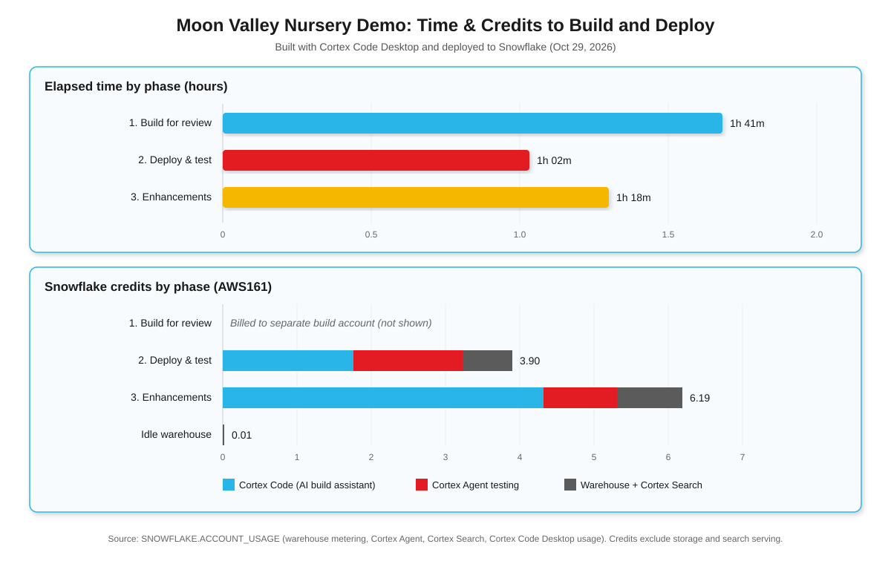

# Moon Valley Nursery Demo — Build Time & Usage

This page summarizes how long it took, and how many Snowflake credits it cost, to build, deploy, and test the Moon Valley Nursery Snowflake Intelligence demo with **Cortex Code Desktop**. The numbers are real usage from the project, not estimates.

## Headline

| | Value |
|---|---|
| **Total elapsed time** | **~4 hours** (one working day, Oct 29, 2026) |
| **Credits on the deployment account** | **~10.1 credits** |
| **Tokens processed (deploy + enhancements)** | **~21.9 million** |
| **What was delivered** | 23 tables, 11 views, 3 Semantic Views, 3 Cortex Search services, 4 ML models + UDFs, Cortex Agent, RBAC + masking policies, managed MCP server, diagrams, and docs |

## Timeline

| Phase | Time (MT) | Elapsed | What happened |
|---|---|---|---|
| 1. Build for review | 12:18 – 13:59 | 1h 41m | Read requirements, confirmed scope, wrote all SQL, notebook, agent spec, diagrams, and docs. Committed to GitHub. |
| 2. Deploy & test | 15:49 – 16:51 | 1h 02m | Ran scripts 01–11, trained and registered 4 ML models, fixed 5 deployment issues, regenerated data, tested search, semantic views, RBAC, and the agent end to end. |
| 3. Enhancements | 16:51 – 18:09 | 1h 18m | Animated vector logo, 5 chart-generating sample questions, README and doc cleanup. |

## Credits by phase (deployment account)

| Phase | Cortex Code (AI assistant) | Cortex Agent testing | Warehouse + Search | **Total** |
|---|---|---|---|---|
| 1. Build for review | Billed to the separate build account* | — | — | — |
| 2. Deploy & test | 1.76 | 1.47 | 0.67 | **3.90** |
| 3. Enhancements | 4.32 | 0.99 | 0.88 | **6.19** |
| Idle warehouse (overnight) | — | — | 0.01 | **0.01** |
| **Total** | **6.08** | **2.45** | **1.57** | **~10.10** |

\*Phase 1 ran on a different Snowflake connection, so its Cortex Code usage isn't in this account's usage views and isn't included here.

## Tokens

| Component | Requests | Tokens |
|---|---|---|
| Cortex Code Desktop | 117 | ~19.3M |
| Cortex Agent (`MOON_VALLEY_AGENT`) | 14 | ~2.6M |
| Cortex Search (3 `MVN_*` services) | — | ~47K |

## Ongoing cost to run the demo

Once deployed, the demo costs very little while idle. The warehouse auto-suspends, and it used about **0.01 credits overnight**. The running costs are:

- **Agent questions:** about **0.1–0.2 credits per question** in testing (2.45 credits across 14 multi-tool questions).
- **Warehouse:** charged only while queries run.
- **Cortex Search serving and storage:** small, ongoing, and not included above.

## Notes and assumptions

- Source views: `SNOWFLAKE.ACCOUNT_USAGE.WAREHOUSE_METERING_HISTORY`, `CORTEX_AGENT_USAGE_HISTORY`, `CORTEX_SEARCH_DAILY_USAGE_HISTORY`, and `CORTEX_CODE_DESKTOP_USAGE_HISTORY`.
- Usage is reported by the hour, so the split between phases 2 and 3 is approximate.
- The Cortex Code figures cover all of this user's Cortex Code Desktop activity in those hours.
- Storage and Cortex Search serving credits aren't included.
- Credit prices vary by contract, edition, and region. Multiply credits by your rate to get a dollar cost.
